# sportsticker enclosure

A 3D-printed case for one Adafruit 64x32 P3 LED matrix (#2279), a Raspberry Pi 4
and the Adafruit RGB Matrix Bonnet (#3211). It has a slim front bezel, a rear
shell that holds the panel with printed pins in the panel's own M3 inserts and
carries the Pi behind it, and a desk stand tilted back 6 degrees. Everything is
printable in PLA or PETG with no supports. The default build needs **no screws,
nuts or other metal hardware**, and no soldering or heat-set inserts. The screw
build is still there as an [option](#screw-build).

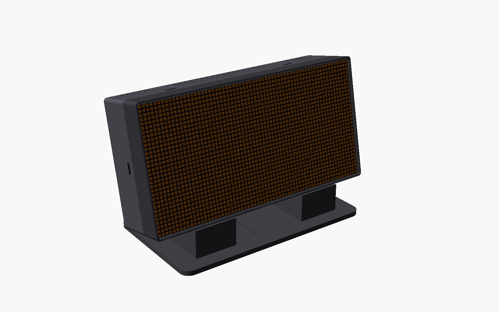

| | |
|---|---|
| Outside size | 196.6 W x 100.6 H x **51.5 D** mm (case only) |
| On the stand | 170 x 100 mm footprint, top of the case about 120 mm above the desk |
| Pi + bonnet stack | 30.2 mm, including the PCB and the 3 mm standoff (see [stack height](#pi--bonnet-stack-height)) |
| Bezel | about 2.5 mm visible border; hides **no** pixels |
| Parts | bezel, shell, stand, 2 spacers, snap pins (plus a test coupon) |
| Print | about 10 h and 190 g of PLA for the whole set, plus about 1 g of pins |

> **Before you print:** several part dimensions could not be read from an
> official drawing. They are marked `UNVERIFIED` in `enclosure.scad`. Print the
> 5 g [test coupon](#test-fit-coupon) first, measure your parts with calipers
> ([how](#unverified-dimensions-and-how-to-measure-them)), edit the numbers,
> and re-export.

## Contents

- [Files](#files)
- [Design summary](#design-summary)
- [Gallery](#gallery)
- [Dimension table and sources](#dimension-table-and-sources)
- [Hardware list](#hardware-list)
- [Print guide](#print-guide)
- [Test-fit coupon](#test-fit-coupon)
- [Assembly](#assembly)
- [Unverified dimensions and how to measure them](#unverified-dimensions-and-how-to-measure-them)
- [Options: diffuser, two panels, wall mount](#options)
- [Collision checks](#collision-checks)
- [Rebuilding the files](#rebuilding-the-files)

## Files

| File | What it is |
|---|---|
| `enclosure.scad` | The parametric model. All dimensions are named, commented parameters at the top, grouped by part. There is one module per part. |
| `stl/bezel.stl` | Front bezel, in print orientation |
| `stl/shell.stl` | Rear shell, in print orientation |
| `stl/stand.stl` | Desk stand |
| `stl/spacers.stl` | 2 spacers that go between the Pi and the bonnet |
| `stl/snap_pins.stl` | The printed pins that replace every screw: 5 panel pins, 3 short and 3 long Pi pins (each with a spare) |
| `stl/coupon.stl` | Test-fit coupon (5 small pieces and 2 test pins, 5 g) |
| `stl/two_panel/` | Split parts for the future 128x32 (two-panel) build |
| `renders/` | Preview PNGs |
| `export.sh`, `render.sh`, `check.sh` | Rebuild the STLs, the PNGs, and the collision checks |
| `stl_binary.py`, `stl_volume.py` | Small helpers used by the scripts |

## Design summary

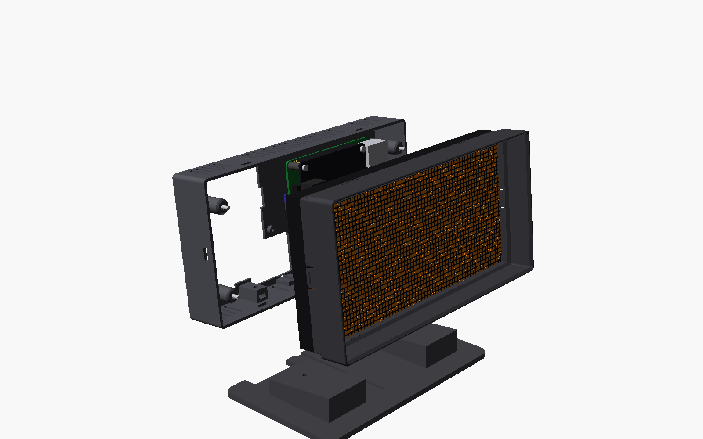

The case has three printed parts:

- **Bezel (front).** A 2 mm front plate whose opening matches the LED area. The
  opening is chamfered at 45 degrees so the outer pixels aren't shadowed at an
  angle. Walls wrap the panel's sides. A tongue at the back slides into the
  shell and clicks in with six snap-fits (two on top, two on the bottom, one at
  each end).
- **Shell (rear).** The panel is held by its own M3 inserts on four hollow posts.
  You push a printed pin from the back down each 7 mm screwdriver well into
  the insert. The Pi sits on four printed standoffs on the inside of the back wall, with its
  components (and the bonnet) **facing the panel**. That is the shallowest
  layout: the 3 mm under the Pi is needed anyway for the microSD socket and
  solder pins.
- **Stand.** A wide base with two pads that follow the 6 degree tilt. Each pad
  has a dovetail tongue that slides into a groove in the shell's bottom, so
  you can remove it without opening the case.

Small printed **snap pins** (`snap_pins.stl`) hold the panel and the Pi in
place of screws.

**Why it holds without screws.** The bezel locates the panel on all four sides,
but it overlaps the LED face by only about 0.15 mm (see item 1 below). It
cannot be the front stop. That is why the panel still needs pins into its own
inserts. The Pi pins clip through the Pi's holes into the back wall. The stand
holds with a dovetail and a small friction wedge, so nothing needs a thread.

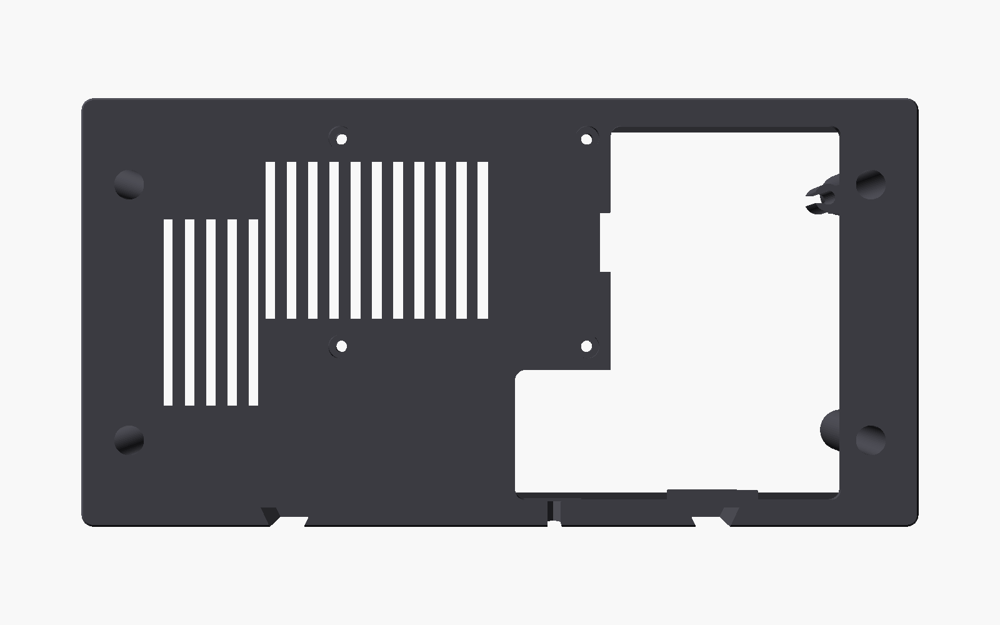

Features:

- **Access bay.** An L-shaped opening in the back, left of and below the Pi
  (seen from behind it is on the right). From the bay you can reach:
  - the **barrel jack**: the plug goes in sideways inside the bay, and the cable
    snaps into a C-clip at the bay's edge;
  - the **USB-C** port: the plug goes in upward, and the cable leaves through a
    gripping slot in the bottom wall;
  - the **microSD** card: there is a finger notch at the card's edge;
  - the panel's **OUTPUT** connector, for a second panel later.

  Both cables leave at the back and bottom, so nothing shows from the front.
- **Strain relief.**
  - The barrel cable snaps into a C-clip that grips it. The clip's inner
    diameter is the cable diameter minus 0.2 mm.
  - The USB-C cable presses into a keyhole slot in the bottom wall.
  - The panel's red and black power lead presses into a two-wire gutter clip on
    a post below the Pi, between the panel's power connector and the bonnet's
    screw terminal. A tug on the lead stops at the clip and never reaches the
    terminal.
- **Vents.** Slots behind the Pi, slots behind the right half of the panel,
  intake slots along the bottom, and exhaust slots along the whole top edge.
  Warm air rises out the top.
- **Ribbon path.** The bonnet's HUB75 socket and the panel's IDC connectors sit
  at 90 degrees to each other. The ribbon therefore makes **one loose 90 degree
  twist-turn**: you twist it, you never crease it.
  - A short ribbon (75 to 108 mm) runs straight to the panel's INPUT and takes
    up any spare length in a gentle S-fold.
  - A long ribbon (about 140 to 190 mm) first drops into the empty space below
    the Pi and makes a soft U-turn (5 mm radius) before the twist.

  Set `ribbon_len` and the model picks the route and checks that it clears
  everything. See the [section view](#pi--bonnet-stack-height).

### Things that turned out differently from the brief

1. **The 1.5 mm lip would hide pixels, so the opening never covers an LED.** This
   panel is made to tile edge to edge: 64 x 3 mm = 192 mm, the full width of the
   panel. The outermost LEDs (SMD2121, 2.1 mm) therefore sit only about
   0.45 mm from the panel edge, and a 1.5 mm lip would cover half of every
   outer pixel. Since "no hidden pixels" is the hard requirement, the opening is
   sized to the LED area plus the fit clearance (191.7 x 95.7 mm). The real
   overlap onto a centred panel is therefore about **0.15 mm**. It still covers
   the 0.3 mm gap around the panel, so no light leaks. `bezel_lip` remains a
   parameter: set `bezel_hides_leds = true` if you'd rather have the 1.5 mm lip
   and accept the clipped edge pixels. OpenSCAD prints a warning while the lip
   is clamped.
2. **One 90 degree ribbon twist is unavoidable** with these two boards (see
   above). A loose twist over about 30 mm is gentle and puts no crease in the
   cable.
3. **"Back or bottom" access** is done through the rear bay rather than holes
   straight through the bottom. The Pi's USB-C port and the bonnet's barrel
   jack face along adjacent edges, at 90 degrees to each other. If both plugs
   came out of the bottom, the stand would need to be about 45 mm tall to fit
   them. With the bay, both plugs sit inside the case's outline and both cables
   leave at the back.

## Gallery

All views show the default build on the 6 degree desk stand. The white block
and rod at the back bottom are the USB-C plug and its cable, leaving through
the gripping slot in the bottom wall. The short black rod higher up is the
barrel-jack cable leaving the C-clip; only its first 25 mm is drawn.

| | |
|---|---|
| 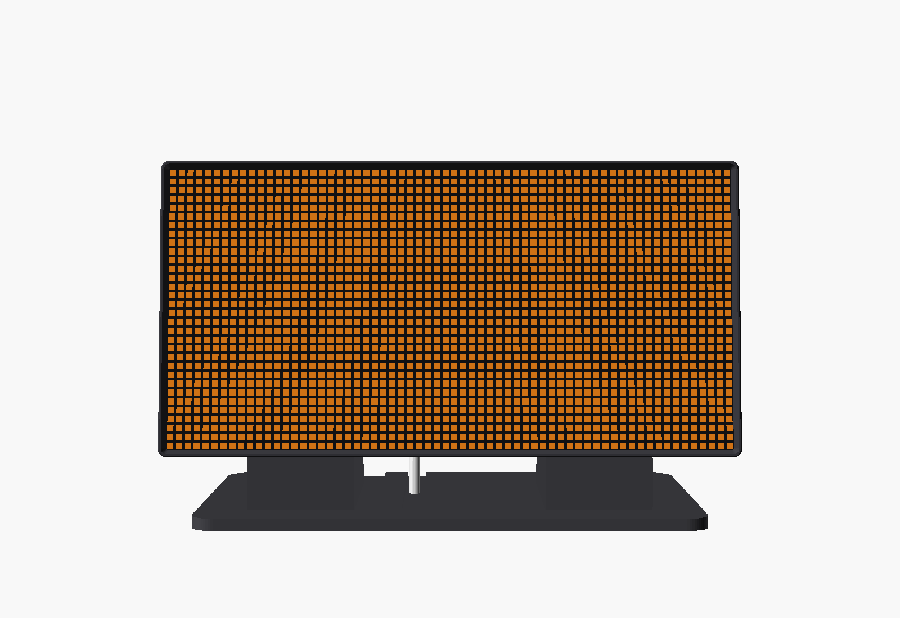 | 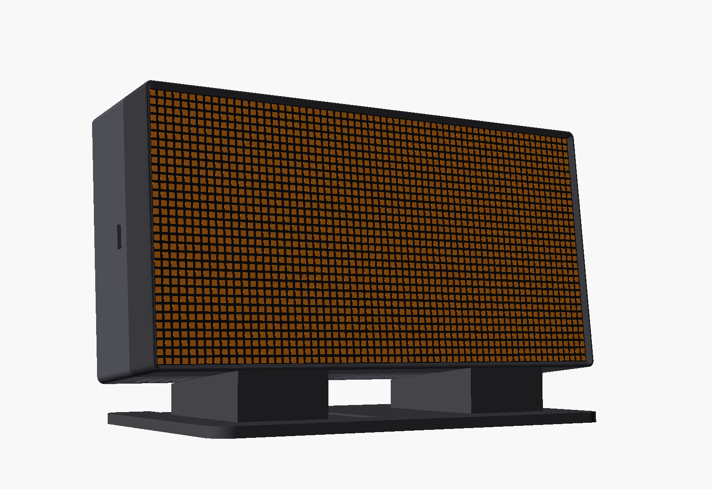 |
| Eye level, straight on | Low angle, from the desk |
| 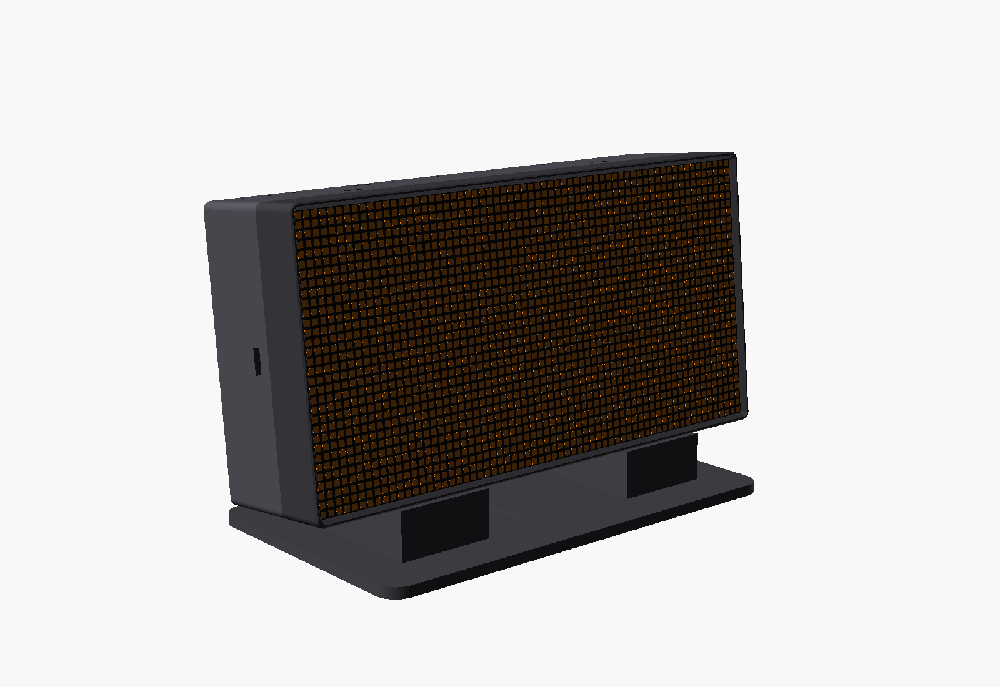 | 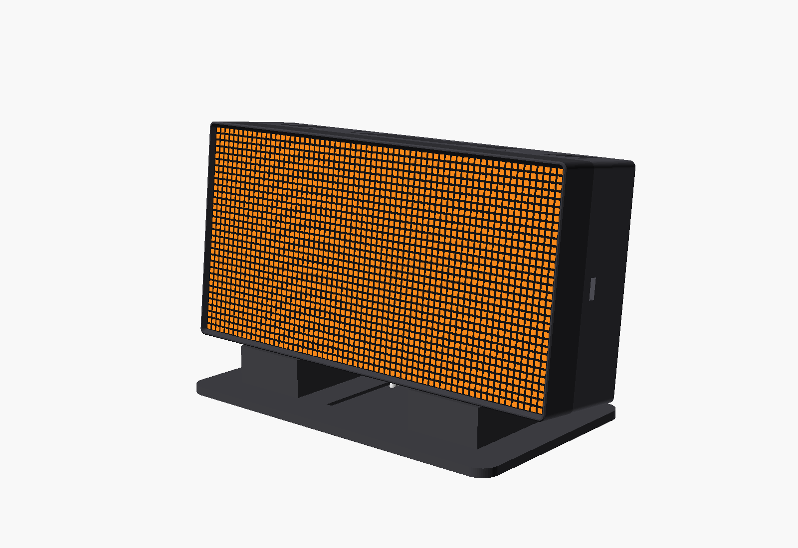 |
| Front, from the left | Front, from the right |
| 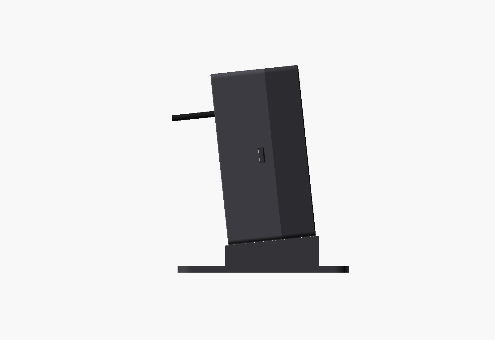 | 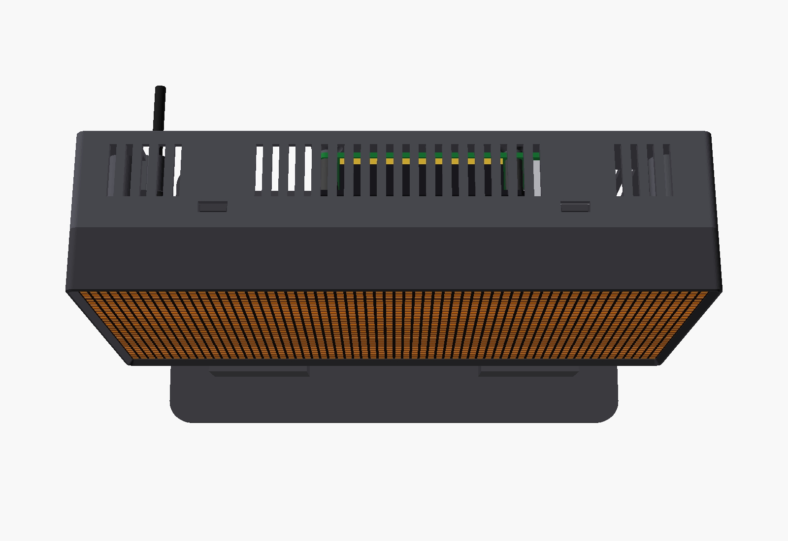 |
| Side profile (orthographic) | Top down, showing the top vents |
| 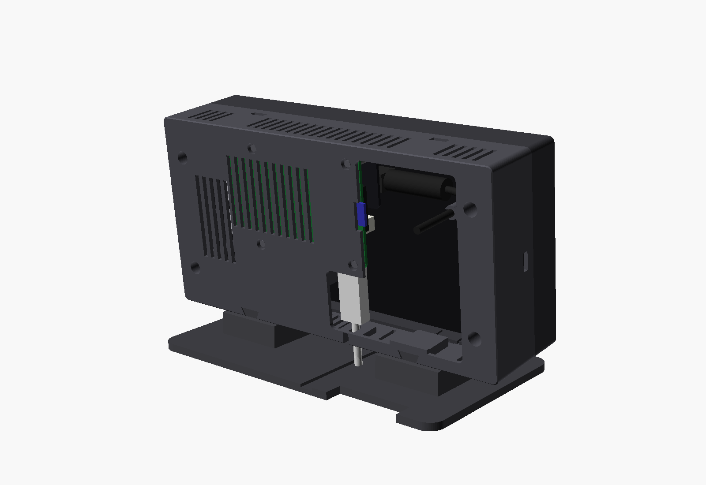 | 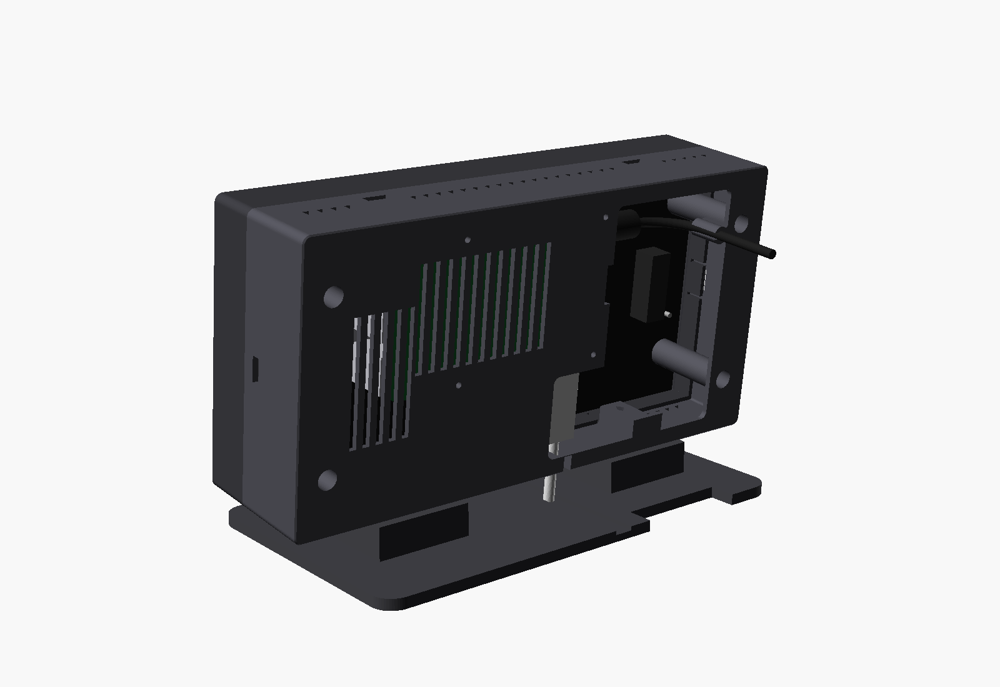 |
| Back, from the left | Back, from the right: access bay, plugs, vents |
| 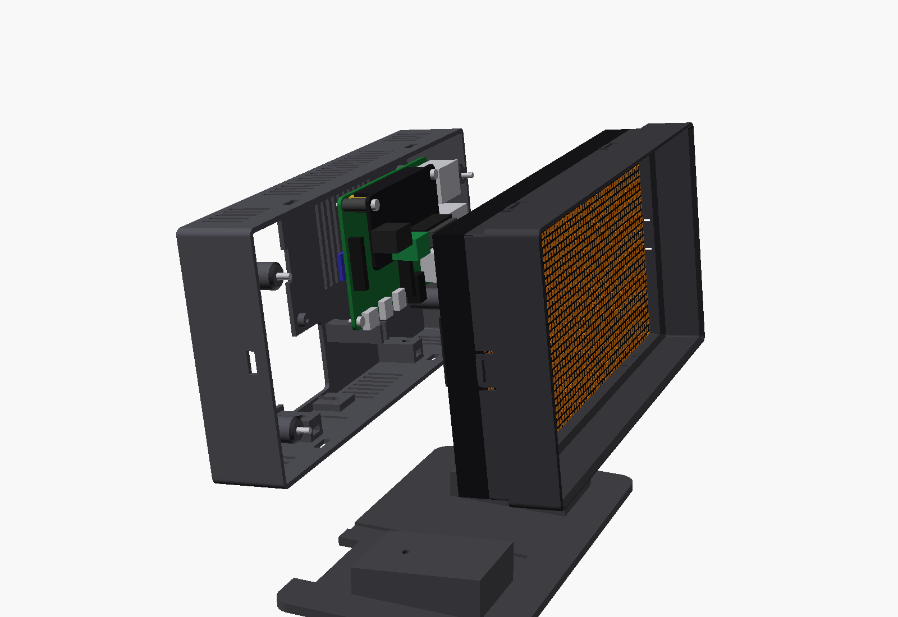 | |
| Exploded: shell with Pi and bonnet, panel, bezel, stand | |

## Dimension table and sources

Sources:

- [Adafruit #2279 CAD drawing](https://cdn-shop.adafruit.com/product-files/2279/2279_CAD.png)
  and [product page](https://www.adafruit.com/product/2279)
- [Raspberry Pi 4 mechanical drawing](https://datasheets.raspberrypi.com/rpi4/raspberry-pi-4-mechanical-drawing.pdf)
- [RGB Matrix Bonnet guide](https://learn.adafruit.com/adafruit-rgb-matrix-bonnet-for-raspberry-pi),
  [product page](https://www.adafruit.com/product/3211), and the Eagle board
  file in [Adafruit's PCB repo](https://github.com/adafruit/Adafruit-RGB-Matrix-Bonnet-PCB)
  (parsed for exact part placement and cross-checked against the dimensioned
  fab print)

**U** = UNVERIFIED (see [how to measure](#unverified-dimensions-and-how-to-measure-them)).

### LED panel

Panel positions are landscape, seen from the front, with the origin at the
panel centre. The CAD drawing is portrait, with its origin at the centre and
comma decimals; it shows the back as a mirror image.

| Parameter | Value | Source |
|---|---|---|
| `panel_w` x `panel_h` | 192 x 96 | Module datasheet "192 x 96". The CAD says 191.8 x 95.8 and the Adafruit page 191 x 96; I take the largest so the panel always fits. **U** |
| `panel_t` (LED face to back mounting face) | 15 | Adafruit page. The CAD side view shows a 10 mm body plus 2.7 mm pins. The sources disagree. **U** |
| `panel_mounts` (M3) | (+-87, +-30) | CAD magenta holes "30" / "87". A vendor photo of another batch shows inserts at about (+-78, +-38). **U** |
| `panel_insert_depth` | 5 | Not in any source. **U** |
| `panel_pins` | (88, 15), (-88, -15), 2.7 tall | CAD "15", "88", "2,7". Diameter about 2 (**U**) |
| `panel_idc_x`, `panel_idc_size` | +-74, 9 x 26 | Vendor back photo (not on the CAD). **U** |
| `panel_pwr_size` | 15 x 7 at the centre | Vendor back photo. **U** |
| `pitch`, `led_size` | 3.0, 2.1 (SMD2121) | Product page, datasheet |

### Raspberry Pi 4

Pi positions use the board's bottom-left corner as origin, top view, with USB
on the right.

| Parameter | Value | Source |
|---|---|---|
| Board, corner radius | 85 x 56, R3 | Drawing |
| `pi_holes` | (3.5,3.5), (61.5,3.5), (3.5,52.5), (61.5,52.5), dia. 2.7, 6 mm pad | Drawing ("58", "49", "3.5", "2.7", "6") |
| `pi_usbc_x` | 11.2 on the bottom edge, 3.2 tall | Drawing ("3.5 + 7.7", Z=3.2) |
| `pi_usba` | y 9 / 27 (Z 16), Ethernet y 45.75 (Z 13.5) | Drawing |
| `pi_gpio_c`, `pi_gpio_h` | (32.5, 52.5), 8.5 | Drawing (Z=8.5) |
| `pi_pcb_t` | 1.6 | Not on the drawing (1.4 is often quoted). **U** |
| `pi_sd_y`, `pi_sd_proud` | 28, 2.5 | Not on the drawing (top view only). **U** |

### Matrix Bonnet

Bonnet positions use the bonnet's bottom-left corner as origin, top view. The
bonnet sits at Pi y = 26 to 56.66.

| Parameter | Value | Source |
|---|---|---|
| Board | 65 x 30.66, 3 mm chamfers | Eagle .brd, fab print "65", "30.7" |
| Holes | (3.5,3.5), (61.5,3.5), (3.5,26.5), (61.5,26.5), dia. 2.8. The top pair lines up with the Pi's top holes (dia. 2.7) | .brd |
| `bonnet_jack` | x -1.27 to 12.93, y 7.95 to 16.95. Faces the **left** edge and sticks out 1.27 past it | .brd, fab print "12.4" |
| `bonnet_jack_h`, `bonnet_jack_axis` | 11, 6.5 | Photo estimate. **U** |
| `bonnet_term` | x 15.24 to 27.94; wires enter from the bottom edge | .brd, fab print "21.6" |
| `bonnet_term_h` | 11.5 | Product page (Sept 2025 revision). Older boards may be taller. **U** |
| `bonnet_hub` | x 30.07 to 58.07, y 0.58 to 9.58 (28 x 9) | .brd, fab print "44" |
| `bonnet_hub_h`, `idc_plug_proud` | 9.0, 3.0 | Typical part. **U** |
| `bonnet_gap` | 11.0 | 2.5 Pi header plastic + 8.5 female header. **U** |

### Pi + bonnet stack height

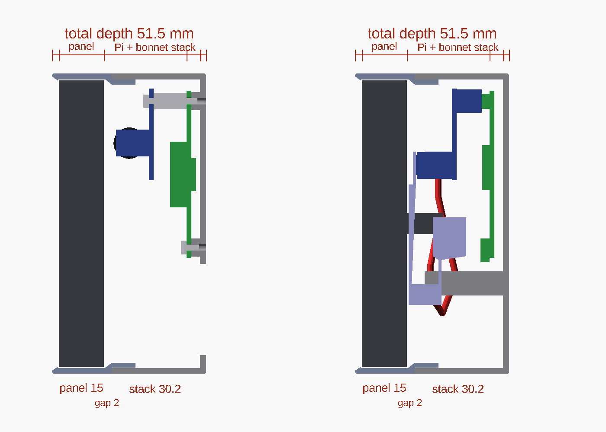

Heights are measured from the Pi PCB's top surface:

- Pi header plastic: 2.5
- Bonnet female header: 8.5, so the bonnet underside sits at **11.0**
- Bonnet PCB: 1.6, so the bonnet top is at **12.6**
- Tallest parts on the bonnet, above its top surface:
  - screw terminal 11.5, reaching 24.1
  - barrel jack about 11, reaching 23.6
  - HUB75 socket 9.0, plus the ribbon plug 3.0 and the ribbon 1.0, reaching **25.6**

The **tallest point is 25.6** (the ribbon plug). The USB-A stack (16) is lower.
Adding the 1.6 Pi PCB and the 3.0 standoff under it gives a full stack of
25.6 + 1.6 + 3.0 = **30.2 mm**.

Depth of the case, front to back:

| Item | mm |
|---|---|
| Bezel front plate | 2.0 |
| Gap in front of the LEDs | 0.3 |
| Panel | 15.0 |
| Clearance between panel and stack | 2.0 |
| Pi + bonnet stack | 30.2 |
| Back wall | 2.0 |
| **Total** | **51.5** |

With the diffuser option the depth becomes 54.7 mm.

## Hardware list

The default build has **no screws, nuts or other metal hardware**. The panel,
the Pi and the stand are all held by printed parts. Nothing here is soldered.

| Qty | Part | Where it goes |
|---|---|---|
| 1 | 16-pin (2x8) IDC ribbon, 75 to 190 mm long | The one that ships with the panel is fine in this range. Measure it and set `ribbon_len`. The model's direct route covers 75 to 108 mm and the U route about 140 to 190 mm. In between, use the direct route with a fuller S-fold (the pocket is 20 mm deep). If yours is longer, use a shorter 2x8 IDC ribbon. |
| 1 | 5 V 4 A supply with a 5.5/2.1 mm barrel plug | Panel power, into the bonnet's jack |
| 1 | USB-C power supply for the Pi (5 V 3 A) | Pi power. The bonnet does not power the Pi. |

Optional:

- **Rubber feet:** 4 adhesive feet, about 10 mm, under the stand.
- **Diffuser:** one sheet of **196 x 100 mm** smoked or dark-grey transparent
  acrylic, 3 mm (or 2 mm with `diffuser_t = 2`). Laser-cutting services and
  plastics shops cut to size.

Tools: tweezers, needle-nose pliers and calipers. A pencil or a screwdriver with
a 6 mm shank pushes the panel pins home. You need **no screwdriver for the
case**. You do need a small flat screwdriver for the bonnet's screw terminal
(that screw is part of the bonnet, not the case) and for the bezel snap
release.

### Screw build

Set `fasteners = "screws"` to get the old build: M3 and M2.5 screws, with the
stand held by two M3 screws and nuts. Export it with
`./export.sh -D 'fasteners="screws"'`. That skips `snap_pins.stl`, and the shell
and stand come out with screw holes and nut slots instead of pin pockets and
dovetails. All screws go into the panel's own inserts, into printed holes, or
into captive nuts.

| Qty | Part | Where it goes |
|---|---|---|
| 4 | **M3 x 8 mm** pan-head or button-head machine screw (ISO 7045 / ISO 7380), A2 stainless or zinc steel | Through the shell's four posts into the panel's M3 inserts. The post floor is 3 mm, so 5 mm of thread goes into the insert. Buy a few **M3 x 6** and **M3 x 10** too, until the coupon tells you your inserts' depth. |
| 2 | **M2.5 x 6 mm** pan-head **thread-forming screw for plastic** (sold as "M2.5 self-tapping"; ST2.5 also works) | The Pi's two lower holes, into the printed standoffs (2.2 mm pilot). An ordinary M2.5 x 6 machine screw also cuts its own thread in PLA. |
| 2 | **M2.5 x 18 mm** pan-head machine screw | Through the bonnet's top holes, the printed spacers and the Pi's top holes, into the standoffs. 3.8 mm of thread bites the plastic; a 20 mm screw would poke out of the back. |
| 2 | **M3 x 12 mm** pan or button head + 2 **M3 hex nuts** (DIN 934, 5.5 mm across flats) | Stand to shell. The nuts slide into slots inside the shell. |

Two-panel screw build: add 2 x M3 x 16 + 2 nuts for the shell joint, and 4 more
M3 x 8 for the second panel.

**Where to buy:**

- **McMaster-Carr** (US): search "pan head Phillips screw M2.5 x 0.45, 18 mm",
  "thread-forming screws for plastic M2.5" and "hex nut M3 x 0.5".
- **Bolt Depot** (US): sells loose metric screws in small quantities.
- **Amazon / AliExpress:** the "M2.5 / M3 stainless button-head screw
  assortment" kits usually include 6, 8, 10, 12 and 16 mm lengths. Check that
  the M2.5 kit goes to 18 or 20 mm.
- **Local hardware store:** M3 x 8, M3 x 12 and M3 nuts are common in the
  metric drawer. M2.5 is rarer.

Screw tools: Phillips #1 (or 2 mm hex for button heads) with a shank of **6 mm
or less** that is at least 35 mm long, to reach down the 7 mm screw wells. A
magnetic tip helps.

## Print guide

Common settings for every part:

- 0.4 mm nozzle, 0.2 mm layers
- 3 perimeters
- 5 top / 4 bottom layers
- 15% gyroid infill
- **no supports**, no brim (a 5 mm brim on the shell helps with PETG)
- Seam: rear or aligned

The STLs are already in print orientation, so don't rotate them.

| Part | Orientation | Supports | Infill | Time* | Filament* |
|---|---|---|---|---|---|
| `bezel.stl` | Front face down. The face gets the bed texture: textured PEI gives a matte finish that hides fingerprints. | None. The opening chamfer is 45 degrees, the tongue ledge is about 51 degrees, and the snap bumps have about 51 degree catch faces. | 15% | 1 h 24 m | 38 g / 12.8 m |
| `shell.stl` | Back face down, open front up | None. The four pin wells end in 7 mm round bridges with two "bridge trick" layers. The Pi pin pockets in the back wall also get two bridge layers. The dovetail grooves close at the stop with a short bridge. If your slicer's auto-support paints anything inside the wells, block it. The other holes that run horizontally in print are teardrops or short flat bridges. | 15% | 5 h 27 m | 80 g / 26.8 m |
| `stand.stl` | Base down | None. The tongue flanks are 25 degrees from vertical. | 15% | 2 h 49 m | 68 g / 22.9 m |
| `spacers.stl` | Standing up (2 pieces) | None | 100% | 6 m | 0.5 g |
| `snap_pins.stl` | As exported, lying flat (11 pieces) | None, no brim | 100% | 15 m | 1 g / 0.3 m |
| `coupon.stl` | As exported (5 pieces and 2 test pins) | None | 15% | 18 m | 5 g |
| **Total** (bezel + shell + stand + spacers + pins) | | | | **about 10 h** | **about 190 g**, plus about 1 g of pins |

\* Estimated with PrusaSlicer 2.7 at MK4 / P1S-class speeds (80 to 200 mm/s,
3000 to 5000 mm/s² acceleration). Bambu Studio's standard profile is in the
same range or a little faster. Older bed-slingers at 50 to 60 mm/s take 1.5 to
2 times as long. Allow +-30%.

Two-panel build: `bezel_left` and `bezel_right` take 1 h 10 m and 32 g each,
`shell_left` and `shell_right` 5 h 33 m and 75 g each, and `stand_left` and
`stand_right` 2 h 11 m and 57 g each. `snap_pins.stl` in `stl/two_panel/` is
1.26 cm³ (about 2 g, 30 min).

Snap pins:

- Print them lying flat, as exported. Use 100% infill.
- **PETG** is better, since it is springier. PLA works.
- Use a 0.2 mm layer, no supports and no brim.
- Turn elephant-foot compensation on, or check that the slits are open.
- Print the spares. The file has them: 4 panel pins plus 1, 2 short Pi pins
  plus 1, and 2 long Pi pins plus 1. The two-panel file has 9 panel pins, 3
  short, 3 long and 3 joint pins.

Material:

- **PLA** is fine for a ticker indoors. PLA starts to soften around 55 to
  60 °C. After an hour at your usual brightness, touch the panel's back: if it
  is uncomfortably warm (above about 45 °C), print the shell in PETG.
- Pick **PETG** if the ticker sits in a sunny window or a hot room. PETG also
  makes the six snap-fits more forgiving and the pins springier. With PETG you may want
  `fit_clear = 0.35`, since PETG prints slightly fat.

Matte black filament gives the best LED contrast and hides light bleed at the
bezel edge.

## Test-fit coupon

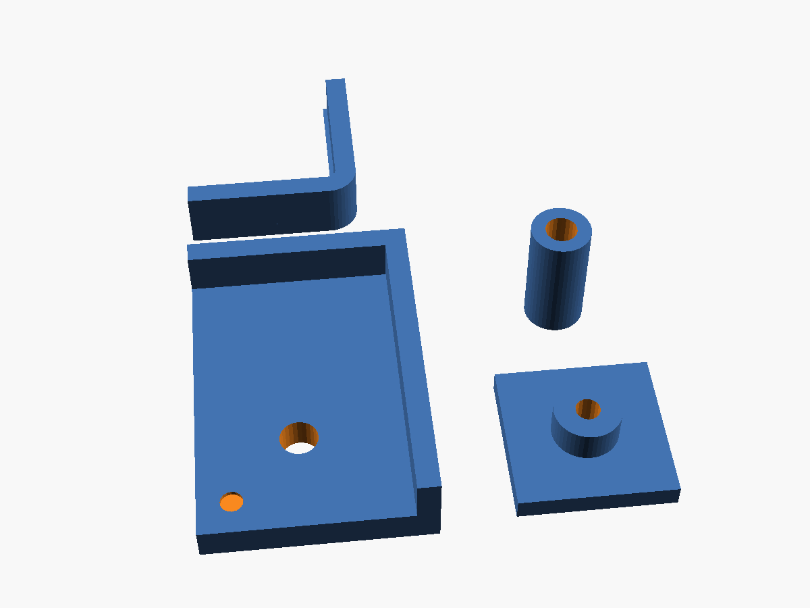

`coupon.stl` (5 g, 18 minutes) checks the fits that are hardest to measure. It
has five pieces, plus one insert pin and one short Pi pin to test with:

- **A: panel corner gauge.** A 3 mm plate (the same thickness as a post's
  floor) with two 4 mm walls at the panel outline.
  1. Lay the panel **face up** into the corner. It should drop in with a hair
     of play.
  2. Push an insert pin through the gauge hole into the corner insert. It
     should grip.
     - If it bottoms out, set `insert_pin_grip` lower. It must stay below
       `panel_insert_depth` - 0.5; OpenSCAD warns if it doesn't.
  3. If the hole doesn't line up with the insert, measure the offset and fix
     `panel_mounts`. The four mounts are symmetric, so one corner tells you all
     four.
- **B: bezel corner.** Set it on the panel's front corner.
  - The outer row and column of LEDs must be fully visible.
  - The outline should fit around the panel without forcing.
- **C: Pi standoff.** It has the same bore and barb pocket as the shell. Push
  a short Pi pin through a Pi hole into it. It should click.
  - If it is too stiff or too loose, change `pi_pin_barb` (bigger = tighter) or
    `pi_pin_slit`.
- **D: spacer.** Its 3.2 mm bore lets a pin's barb slide through. With the
  bonnet pressed fully onto the Pi, the gap between the boards should match its
  length (10.8 mm). If not, set `bonnet_gap`.
- **E: dovetail.** A groove block and a tongue with the wedge end. Slide the
  tongue into the groove. It should slide freely at first and lock over the
  last few mm. If it jams, lower `dt_lock`. If it stays loose, raise it.

With `fasteners = "screws"` the coupon has only A to D, with these tests
instead:

- **A:** drive an M3 x 8 up through the hole into the corner insert.
  - If it pulls the panel tight, M3 x 8 is right.
  - If it bottoms out before it clamps, use M3 x 6.
  - If it barely catches, use M3 x 10.
- **C:** hold it under one of the Pi's holes and drive an M2.5 x 6 through. It
  should bite firmly. If it strips easily, set `m25_tap_d = 2.1`. If it's very
  stiff or splits the post, set 2.3.
- **D:** it should slide over an M2.5 screw.

## Assembly

Follow this order. Read it through once first.

### 1. Bonnet onto the Pi

1. Put the microSD card in the Pi now. You can also do this later through the
   bay.
2. Stand the two printed **spacers** on the Pi's two holes next to the GPIO
   header.
3. Press the bonnet straight down onto the header until it rests on the
   spacers. Check that no pins are offset by one row.

### 2. Pi into the shell

1. Lay the shell on its back with the open front facing up.
2. Lower the Pi in with the **components facing up** (toward you):
   - the microSD edge faces the large access bay;
   - the USB-C edge faces the bottom.

   The four standoffs line up with the Pi's holes.
3. Push two **short Pi pins** through the Pi's lower holes, next to the USB-C
   port, into the standoffs.
4. Push two **long Pi pins** down through the bonnet's top holes, the spacers
   and the Pi's top holes, into the upper standoffs.
5. Each pin goes in from the front, like a screw. Its barb (3.3 mm) squeezes
   through the hole and clicks into the pocket behind the standoff. The catch
   face is sloped, so a 1.4 to 1.6 mm Pi PCB is clamped either way.

To release a Pi pin, squeeze the barb's two prongs together in the pocket at the
back of the case with tweezers, and push the pin out toward the front.

### 3. Ribbon to the panel's INPUT

1. Lay the panel **face down** on a soft cloth.
2. Stand the shell on its bottom edge right next to the panel, open side facing
   the panel's back, like a book about to close.
3. Plug the ribbon into the bonnet's HUB75 socket. The key bump faces the GPIO
   header. The ribbon leaves the plug over the bonnet's lower edge.
4. Find the panel's **INPUT** connector. It is labelled on the PCB; the data
   arrows point *away* from it. It must end up on the side **away from** the
   access bay.
   - If it's on the bay side, turn the panel 180 degrees and later set
     `pixel_mapper_config: "Rotate:180"` in `config.yaml`. No reprint is
     needed: the mounting pattern is symmetric.
5. Route the ribbon:
   - **Long ribbon (U route):** take it down the front of the Pi, into the
     space below the Pi, then let it turn back in a soft U and rise behind
     itself.
   - **Short ribbon (direct route):** go straight on.

   Either way, give it **one loose 90 degree twist** (about 3 cm long) so it
   lies flat along the panel toward the INPUT. Never crease it.
6. Plug it into INPUT.

### 4. Power wires into the screw terminal

1. Loosen the bonnet's two terminal screws.
2. Put the panel power cable's **red** lead into **+** and **black** into **-**.
   These are marked next to the terminal (the "5V Out" side). Tighten.
3. Plug the cable's other end into the panel's power connector.
4. Press the red and black wires **side by side** into the gutter clip on the
   post below the Pi. Leave a small slack loop between the clip and the
   terminal, so a pull on the lead stops at the clip.

### 5. Panel onto its mounts

1. Tip the shell over onto the panel's back like closing a book. The four posts
   land on the panel's corner inserts.
2. Check that no wire or ribbon is pinched under a post or against the Pi.
   The ribbon should lie flat along its path.
3. With the shell's back now facing up, drop an **insert pin** down each of the
   four screwdriver wells. The head (6 mm) sits on the post floor. Push each
   one home with a pencil, a 6 mm screwdriver shank or similar. Its 3.0 mm
   split end springs 4 mm into the insert and grips the thread.

To remove an insert pin, pull it out with needle-nose pliers or tweezers. A
slight twist helps. If a pin ever won't grip, an **M3 x 8** screw still fits
the same post.

### 6. Bezel on

1. Stand the case up. Slide the bezel over the panel from the front, keeping
   it square.
2. Push until all six snaps click: two on top, two on the bottom, one each end.
   The bezel's walls butt against the shell's rim.

To remove the bezel, push each bump in through its window in the shell with a
small flat screwdriver while you pull the bezel forward.

### 7. Stand and cables

1. Set the case on the front of the stand, slightly forward. Line the two
   grooves in the shell's bottom up with the stand's tongues and slide the
   case back until it stops. The grooves are open at the back and closed 18 mm
   forward. The 6 degree tilt pushes the case toward the stop. The last 2 to
   4 mm of each tongue are a 0.1 mm per side friction wedge, so the case stays
   on when you carry it. To remove it, pull the case forward. You don't open
   the case.
2. Through the bay, push the barrel plug into the bonnet's jack. Snap its
   cable into the C-clip at the bay's edge.
3. Push the USB-C plug up into the Pi. Press its cable into the slot in the
   bottom wall. It runs back along the groove in the stand.

## Unverified dimensions and how to measure them

Measure each with calipers, edit the parameter at the top of `enclosure.scad`,
then run `./check.sh` and `./export.sh`. The ones in **bold** affect fit and
are the ones to measure before the full print.

| Parameter | Default | How to measure |
|---|---|---|
| **`panel_w`, `panel_h`** | 192, 96 | Measure the outer edge of the panel's plastic frame, across the LED face, at both ends and in the middle. Use the **largest** reading. |
| **`panel_t`** | 15 | Lay the panel face down on a flat table. Put the caliper's depth rod on the **flat back mounting face**, the face the M3 inserts sit in (not on the connectors or the 2.7 mm pins), and measure down to the table. If the frame's back face isn't flat, use the surface around the insert holes. This sets where the bezel lands: too small and the bezel won't close; too big and the panel sits recessed. |
| **`panel_mounts`** | (+-87, +-30) | First identify the **M3 inserts**: brass, threaded, usually 4 to 6 of them. Then measure **outside to outside** and **inside to inside** of the hole between two inserts in a row, and average to get the centre-to-centre distance. Halve it to get the coordinate. Do this in both directions. Also check from a panel edge to an insert's centre: edge to near side of the hole plus half the hole diameter. Use the coupon's piece A to confirm. |
| **`panel_insert_depth`** | 5 | Push the caliper's depth rod into an insert until it stops. `insert_pin_grip` must stay at least 0.5 mm below it. In the screw build, screw length = 3 + this, rounded down to a stock length (6, 8 or 10). |
| `panel_pins`, `panel_pin_d`, `panel_pin_h` | (88,15), 2, 2.7 | Locating pins on the back: measure their positions as for the inserts, plus diameter and height. They only need to miss the posts and the bezel tongue. |
| **`panel_idc_x`, `panel_idc_size`** | 74, 9 x 26 | Centre of each 16-pin connector's plastic box from the panel centre, plus the box's outer width and length. |
| **`panel_idc_proud`** | 9 | With the **ribbon plugged in**, from the back mounting face to the top of the plug and ribbon. |
| `panel_input_side` | +1 | Seen from the front, which side INPUT is on. Look for "INPUT" on the PCB or the arrows. You can rotate the panel instead of changing this. |
| `panel_pwr_size`, `panel_pwr_proud` | 15 x 7, 12 | The centre power connector's box, and how far the plug and wires stand off the back face with the cable connected. |
| `pi_pcb_t` | 1.6 | Board thickness at an edge away from parts. |
| `pi_sd_y` | 28 | Pi on its back, SD slot facing you: from the board's bottom edge (the USB-C / HDMI edge) to the centre of the card slot. |
| `pi_sd_proud` | 2.5 | With a card fully seated, how far it sticks out past the board edge. |
| **`bonnet_gap`** | 11.0 | Bonnet pressed fully onto the Pi: gap between the Pi's top surface and the bonnet's underside, at the corner holes. Sets the spacer length and the long Pi pin's grip (17.2 mm). In the screw build it sets the M2.5 x 18 screw. |
| `bonnet_jack_h`, `bonnet_jack_axis` | 11, 6.5 | Jack height above the bonnet's top surface, and the height of the barrel's centre. |
| **`bonnet_term_h`** | 11.5 | Screw terminal height above the bonnet's top surface. Pre-Sept-2025 boards may be taller. |
| `bonnet_hub_h`, `idc_plug_proud` | 9, 3 | HUB75 shroud height above the bonnet. With the ribbon plugged in, how far the plug sticks out above the shroud. |
| **`ribbon_len`** | 150 | Between the two plugs, laid straight. |
| `barrel_plug_d`, `barrel_plug_len`, `barrel_cable_d` | 10.5, 32, 3.5 | Plug body's largest diameter; from the end of the metal barrel's shoulder to the end of the strain relief; cable diameter. **`barrel_cable_d` sets the clip's grip.** |
| `usbc_plug_size`, `usbc_plug_len`, `usbc_cable_d` | 12.5 x 6.8, 28, 4.0 | Overmould width and thickness; length from the connector's shoulder to the end of the boot; cable diameter (sets the slot's grip). |
| `pwr_wire_d` | 2.2 | One red or black wire's outer diameter (sets the gutter clip's grip). |

After any change, run `./check.sh`. Every line should say "empty" or
"OVERLAP volume 0.00" (touching faces).

## Options

Edit these at the top of `enclosure.scad`, or pass them with `-D` to the scripts.

- **Diffuser.** `use_diffuser = true` and `diffuser_t = 3` (or 2). The case grows
  to 200.6 x 104.6 x 54.7 mm and takes a 196 x 100 mm sheet. The sheet is held
  between the bezel's front plate (about 2 mm of overlap all round) and the
  panel.

  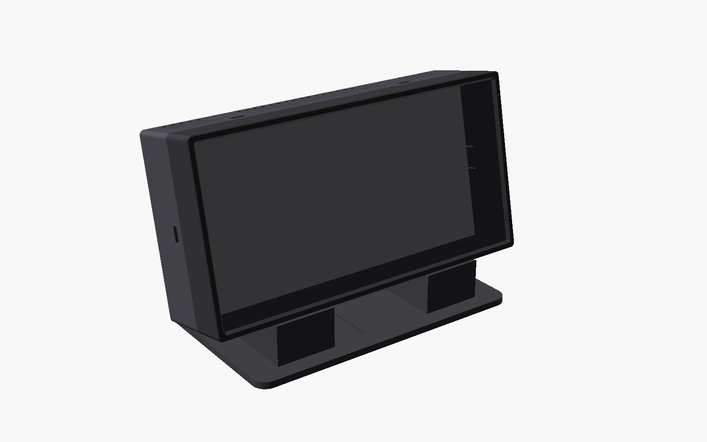

- **Fasteners.** `fasteners = "printed"` is the default: snap pins and
  dovetails, no metal hardware. `fasteners = "screws"` gives the screw build,
  for example `./export.sh -D 'fasteners="screws"'`. Its parts list is under
  [Screw build](#screw-build).

- **Two panels (128x32).** `panels = 2`. The case is 388.6 mm wide, so
  `./export.sh -D panels=2` writes split parts to `stl/two_panel/`:
  - left and right bezel and shell halves, each 194.3 mm, which fit a 250 mm
    bed;
  - two independent stand feet;
  - 4 alignment pins;
  - `snap_pins.stl`: 9 panel pins, 3 short and 3 long Pi pins, and 3 joint
    pins (1.26 cm³).

  The shell halves join with the alignment pins and a printed joint pin in
  blocks at the top and bottom. The joint pin has a 3.0 mm shank and a 3.9 mm
  barb. Its head sits in the 6.2 mm recess and the barb catches in the nut
  trap, in place of an M3 x 16 bolt and a nut (which the screw build still
  uses). The bezel halves are located by the shell and
  held by their own snaps. The Pi stays behind the left panel. Panel 1's OUTPUT
  is reachable through the bay. Check the jumper ribbon to panel 2 when you get
  there.

  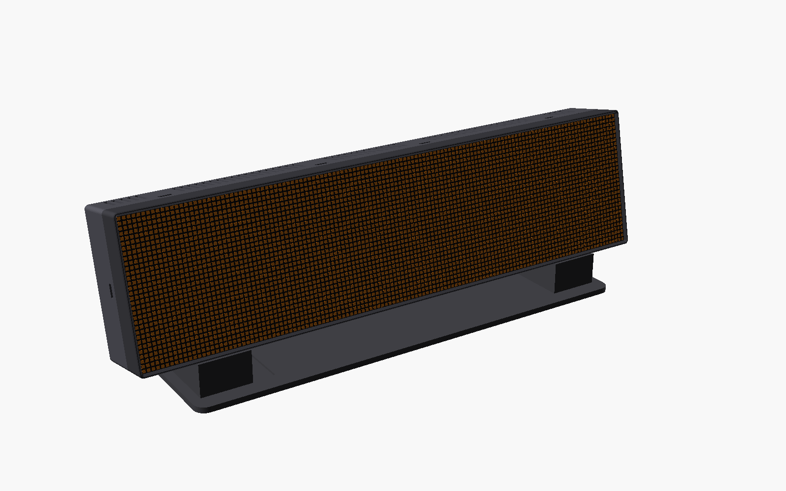

- **Wall mount.** `wall_mount = true` adds two keyhole slots, with closed
  pockets behind them, to the back wall. The case hangs on two wall screws or
  nails. Those go in the wall, not the case. It is off by default because you chose
  the desk stand. `desk_stand = false` removes the stand bosses.
- **Tilt.** `stand_tilt` (default 6).
- **Bed.** `bed_x`, `bed_y`. Parts are split automatically when the case is
  wider than the bed.

## Collision checks

`./check.sh` uses CGAL to compute the actual overlap volume between each pair
of models: case parts, Pi + bonnet + pins, the LED panel with its plugs, the
barrel and USB-C plugs and cables, the ribbon's keep-out path, and the power
lead. Results for the default build:

| Check | Result |
|---|---|
| shell vs Pi stack | touching only (standoffs, pins) |
| shell vs panel | touching only (posts on the back face) |
| bezel vs panel | no contact (0.3 mm all round, 0.3 mm in front) |
| Pi stack vs panel | no contact (2 mm) |
| shell vs plugs and cables | no contact |
| plugs vs Pi stack and panel | touching only (plugs seated in their jacks) |
| shell, Pi, panel, power lead vs ribbon | no contact (both routes, `ribbon_len` 90 to 185) |
| clips vs everything else | no contact |
| bezel vs shell | touching only (butt joint) |
| stand vs case | no contact |

The same checks pass with `use_diffuser = true`, with `panels = 2` and with
`fasteners = "screws"`. The stand check uses the tongue without its wedge,
since the wedge is a deliberate press fit. The clips
grip their cables by design: the barrel clip is 0.2 mm under the cable diameter,
and the USB-C slot and gutter clip are snug. These checks therefore use the
shell without its clips (`check_clips_hw` covers the clips against everything
else).

The checks are only as good as the dimensions: re-run them after you measure.

## Rebuilding the files

You need OpenSCAD 2021.01 or newer, and ImageMagick for the combined section
image.

- macOS: `brew install --cask openscad` and `brew install imagemagick`
- Debian / Ubuntu: `sudo apt install openscad imagemagick xvfb`

```sh
cd enclosure
./export.sh                      # STLs into stl/ (binary, print orientation)
OUT=stl/two_panel ./export.sh -D panels=2
./export.sh -D 'fasteners="screws"'  # the screw build (no snap_pins.stl)
./render.sh                      # PNGs into renders/
./check.sh                       # collision checks
openscad enclosure.scad          # GUI with the customizer
```

Every script passes extra `-D name=value` arguments through to OpenSCAD, for
example `./check.sh -D panel_t=13.2`. From the repository root, `make enclosure`
and `make enclosure-check` do the same.
